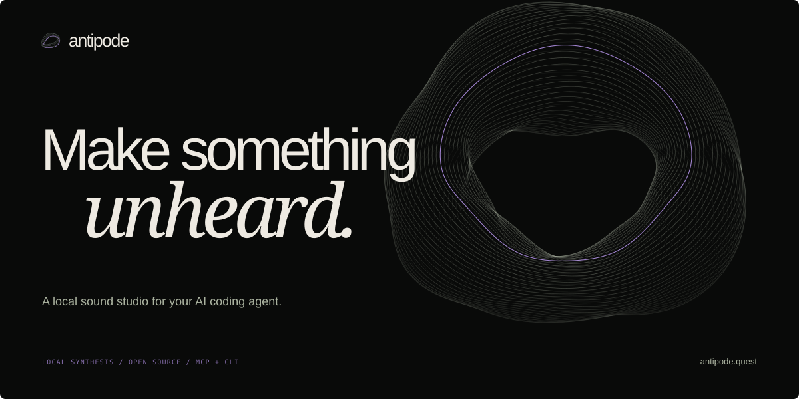

<p align="center">
  
</p>

<h3 align="center">Sound creation for AI coding agents.</h3>

<p align="center">
  An instrument inside your agent. Deterministic procedural DSP on your disk.<br>
  <strong>Zero sample libraries · Zero model weights · 100% local</strong>
</p>

<p align="center">
  <a href="https://github.com/mchl-schrdng/antipode-audio/actions/workflows/check.yml"></a>
  <a href="LICENSE"></a>
  <a href="examples/LICENSE"></a>
  <a href="pyproject.toml"></a>
  <a href="https://antipode.quest"></a>
</p>

<p align="center">
  <a href="https://antipode.quest">Listening Room</a> ·
  <a href="#quick-install">Quick Install</a> ·
  <a href="#the-instrument">The Instrument</a> ·
  <a href="#cli-usage">CLI</a> ·
  <a href="docs/integrations.md">Agent Setup</a> ·
  <a href="docs/rights.md">Rights & Provenance</a>
</p>

---

Describe a texture, a UI gesture, or a cinematic atmosphere. Your coding agent composes a declarative JSON recipe; **Antipode** synthesizes it locally into a 48 kHz PCM16 WAV, analyzes its spectral and spatial profile, and refines it iteratively.

> *"A low, slowly breathing A1 drone. Brittle glass gliding from A4 to E5 while panning left to right. A distant metallic impact dissolving into dark stereo reverb. Ten seconds."*

```text
Your brief ──► Coding Agent ──► Local MCP (stdio) ──► Procedural DSP ──► 48 kHz WAV + Spectral Report
```

---

## Listening Room

Three original studies synthesized entirely by the bundled engine — no external samples or recordings:

| Study | Character | Audio | Recipe |
| :--- | :--- | :--- | :--- |
| **Event Horizon** | Deep breathing sub-drone (`55 Hz`), detuned stereo pads, sparse glass & metallic decay | [Listen / WAV](examples/audio/event-horizon.wav) | [`event-horizon.json`](examples/recipes/event-horizon.json) |
| **Glass Orbit** | Shimmering inharmonic glass resonances orbiting across the stereo field | [Listen / WAV](examples/audio/glass-orbit.wav) | [`glass-orbit.json`](examples/recipes/glass-orbit.json) |
| **Afterimage** | Accelerating filtered riser landing in a deep sub impact and metallic tail | [Listen / WAV](examples/audio/afterimage.wav) | [`afterimage.json`](examples/recipes/afterimage.json) |

Experience them interactively in the live listening room at **[antipode.quest](https://antipode.quest)**.

---

## Quick Install

Install **[uv](https://docs.astral.sh/uv/getting-started/installation/)** once and keep it on your `PATH`. Antipode prepares Python and its locked dependencies (`numpy`, `mcp`) automatically on first launch and runs 100% offline afterward.

### Claude Code

```sh
claude plugin install antipode --marketplace mchl-schrdng/antipode-audio
```

Or run `/plugin install antipode --marketplace mchl-schrdng/antipode-audio` inside a Claude Code session.

### Codex

```sh
codex plugin marketplace add mchl-schrdng/antipode-audio
codex plugin add antipode@antipode-local
```

### Gemini CLI

```sh
gemini extensions install https://github.com/mchl-schrdng/antipode-audio
```

### Antigravity & OpenCode

See the **[Agent Integration Guide](docs/integrations.md)** for native Antigravity bundles and OpenCode project configuration.

---

## The Instrument

### 1. MCP Tools

Antipode runs as a local `stdio` process (`antipode-mcp`) with no daemon, API key, or network activity. All outputs are written atomically to the workspace (`~/.antipode/audio` by default) and existing files are never overwritten.

| Tool | Role |
| :--- | :--- |
| `list_presets` | Discover the 16 built-in procedural synthesis voices |
| `generate_sound` | Render a single mono voice by frequency (`20–8000 Hz`) or scientific pitch (`E0–B8`) |
| `render_recipe` | Synthesize and mix up to 16 stereo layers with pitch glides, panning, per-layer filters & master effects |
| `process_audio` | Apply high-pass/low-pass filtering, gain, fades, reversal & peak normalization to an existing WAV |
| `analyze_audio` | Measure peak/RMS dBFS, transient peak time, AC spectral centroid (Hz), stereo balance & clipping |

### 2. Sixteen Procedural Voices (4 × 4 Matrix)

| Family | Preset | Synthesis Topology | Suggested Range |
| :--- | :--- | :--- | :--- |
| **Foundations & Pads** | `tone` | Pure sine oscillator for sub reinforcement and clean UI cues | `40–2000 Hz` (`E1–B6`) |
| | `drone` | Slowly beating subharmonics, detuned overtones and gentle FM | `55–110 Hz` (`A1–A2`) |
| | `pad` | Eight detuned harmonic pairs with slow spectral bloom | `110–440 Hz` (`A2–A4`) |
| | `choir` | Breathing vocal-formant harmonic ensemble with gentle `5.2 Hz` vibrato | `110–520 Hz` (`A2–C5`) |
| **Melodic & Resonant** | `pluck` | Plucked harmonic string with fast high-partial damping | `110–880 Hz` (`A2–A5`) |
| | `chime` | Three exponentially decaying harmonic partials | `220–2000 Hz` (`A3–B6`) |
| | `bell` | FM struck bell with decaying spectral brightness and warm hum | `220–1200 Hz` (`A3–D6`) |
| | `glass` | Delicate inharmonic glass partials with a long decaying shimmer | `440–1200 Hz` (`A4–D6`) |
| **Impacts & Rhythm** | `kick` | Pitch-dropping sine transient falling to a quarter of its start frequency | `120–220 Hz` (`B2–A3`) |
| | `wood` | Hollow woody modal strike (`1 : 2.57 : 4.64`) for organic percussion & UI clicks | `150–900 Hz` (`D3–A5`) |
| | `metal` | Six inharmonic struck resonators with a crisp noise burst attack | `90–500 Hz` (`F#2–B4`) |
| | `pulse` | Warm breathing harmonic pulses modulated at `2.5 Hz` | `55–220 Hz` (`A1–A3`) |
| **Motion & Air** | `sweep` | Rising or gliding tonal sweep | `110–1760 Hz` (`A2–A6`) |
| | `riser` | Cubic accelerating tonal sweep through filtered air | `220–2000 Hz` (`A3–B6`) |
| | `wind` | Slowly swelling dark filtered noise shaped around the target frequency | `100–800 Hz` (`G2–G5`) |
| | `noise` | Deterministic seeded white noise source | Seeded (`0–2³²−1`) |

### 3. Declarative Sound Recipes

Recipes are plain, version-controllable JSON objects supporting scientific notes (`E0–B8`), exponential pitch glides (`note` → `note_end`), constant-power stereo movement (`pan` → `pan_end`), per-layer filters (`highpass_hz`, `lowpass_hz`), and master bus DSP:

```json
{
  "duration": 8,
  "seed": 73,
  "peak_db": -3,
  "layers": [
    {
      "preset": "drone",
      "duration": 7.2,
      "note": "A1",
      "level_db": -6,
      "lowpass_hz": 900,
      "fade_in": 1.2,
      "fade_out": 2.0
    },
    {
      "preset": "glass",
      "start": 1.5,
      "duration": 4.5,
      "note": "A4",
      "note_end": "E5",
      "level_db": -14,
      "pan": -0.7,
      "pan_end": 0.7,
      "fade_in": 0.05,
      "fade_out": 1.8
    }
  ],
  "effects": {
    "highpass_hz": 30,
    "lowpass_hz": 8000,
    "drive": 1.2,
    "delay_seconds": 0.375,
    "delay_feedback": 0.35,
    "delay_mix": 0.15,
    "reverb_seconds": 2.4,
    "reverb_mix": 0.35
  }
}
```

---

## CLI Usage

```sh
git clone https://github.com/mchl-schrdng/antipode-audio.git
cd antipode-audio

# Generate a single voice by scientific pitch or frequency
uv run --locked antipode --workspace ./my-sounds generate ui-chime.wav --preset glass --note A4 --duration 1.5

# Render a multi-layer stereo recipe
uv run --locked antipode --workspace ./my-sounds render examples/recipes/event-horizon.json event-horizon.wav

# Filter and normalize an existing WAV without overwriting the source
uv run --locked antipode --workspace ./my-sounds process event-horizon.wav dark-horizon.wav --lowpass-hz 1200 --normalize-db -3

# Inspect level, transient timing, spectral centroid and stereo balance
uv run --locked antipode --workspace ./my-sounds analyze dark-horizon.wav
```

---

## Development & Continuous Integration

Every push and pull request is verified across **Linux (Python 3.11 & 3.12)**, **macOS (Python 3.12)**, and **Windows (Python 3.12)** via [GitHub Actions](https://github.com/mchl-schrdng/antipode-audio/actions/workflows/check.yml):

| Check | Scope |
| :--- | :--- |
| **DSP & Synthesis** (`test_engine.py`, `test_composition.py`) | Bit-accuracy of the 3 reference studies, exponential glides, constant-power panning, per-layer & multi-rate filtering, DC-free spectral centroid, concurrent atomic writes |
| **Path & Format Safety** (`test_engine.py`) | Workspace confinement, symlink/traversal rejection, Windows drive/ADS rejection, malformed RIFF/WAV handling |
| **Transports** (`test_cli.py`, `test_mcp.py`, `test_integrations.py`) | CLI commands, real `stdio` MCP subprocesses (modern & legacy negotiation), offline plugin manifest launches |
| **Reproducible Packaging** (`test_distribution.py`) | Deterministic SHA-256 ZIP bundles for portable Agent Plugins and Antigravity |

Run the full suite locally:

```sh
uv run --locked python -m unittest discover -s tests -v
uv build
uv run --locked python scripts/build_plugin.py
uv run --locked python scripts/build_plugin.py --client antigravity
```

---

## Rights & Provenance

- **Software & original vector artwork:** [Apache-2.0](LICENSE).
- **Bundled demo audio & recipes:** [CC0-1.0](examples/LICENSE), to the extent contributors hold rights.
- **Your renders:** Antipode claims no ownership, royalty, or attribution requirement over audio you generate.
- **Notices:** Read [Rights & Provenance](docs/rights.md) and [Third-Party Notices](THIRD_PARTY_NOTICES.md) (note: the working name *Antipode* has not undergone formal trademark clearance).
