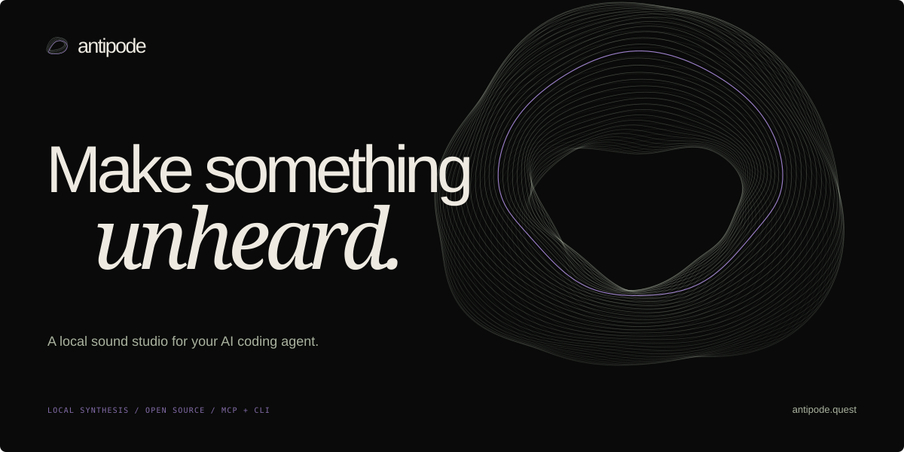

<p align="center">
  
</p>

<p align="center">
  <strong>Sound creation for AI coding agents.</strong><br>
  An instrument inside your agent. A sound on your disk.
</p>

<p align="center">
  <a href="https://antipode.quest">Listening room</a> ·
  <a href="#get-started">Install</a> ·
  <a href="docs/integrations.md">Connect your agent</a> ·
  <a href="docs/rights.md">Rights & provenance</a>
</p>

<p align="center">
  <a href="https://github.com/mchl-schrdng/antipode-audio/actions/workflows/check.yml"></a>
</p>

---

Describe a texture, a gesture, an atmosphere. Your agent turns it into a recipe;
Antipode synthesizes it locally and exports a WAV you can keep refining.

> A low, slowly breathing drone. Brittle glass moving left to right.
> A distant metallic impact that dissolves into space. Ten seconds.

**Local DSP. Open source. No sample library. No model weights.**

Antipode is a Python CLI and an MCP instrument with agent skills and installation
configurations for **Codex, Claude Code, Gemini CLI, Antigravity and OpenCode**. It is an early
release; see the [integration checks](docs/integrations.md#verification-scope) for what has actually
been tested in each host. It is not a VST/AU instrument or a neural text-to-music
model.

## Start listening

Three original studies, made entirely by the included engine. Each has an editable
recipe; no recording was sampled.

| Study | Sound | Recipe |
| --- | --- | --- |
| **Event Horizon** | [Listen / download WAV](examples/audio/event-horizon.wav) | [Rebuild it](examples/recipes/event-horizon.json) |
| **Glass Orbit** | [Listen / download WAV](examples/audio/glass-orbit.wav) | [Rebuild it](examples/recipes/glass-orbit.json) |
| **Afterimage** | [Listen / download WAV](examples/audio/afterimage.wav) | [Rebuild it](examples/recipes/afterimage.json) |

Visit the live listening room at [antipode.quest](https://antipode.quest).
Its deployment source is maintained separately from this public instrument repository.

## Get started

Install [uv](https://docs.astral.sh/uv/getting-started/installation/) once and keep
it on your agent application's PATH. Antipode prepares Python and its locked
dependencies automatically on first launch. No separate Python setup, GPU or
Antipode account is needed.

**Claude Code — one command:**

```sh
claude plugin install antipode --marketplace mchl-schrdng/antipode-audio
```

Or run `/plugin install antipode --marketplace mchl-schrdng/antipode-audio` inside
Claude Code. Start a new session and ask for a sound with Antipode.

**Codex:**

```sh
codex plugin marketplace add mchl-schrdng/antipode-audio
codex plugin add antipode@antipode-local
```

**Gemini CLI:**

```sh
gemini extensions install https://github.com/mchl-schrdng/antipode-audio
```

Restart Gemini CLI after installation. The Gemini release is `gemini-v0.1.2`;
the earlier v0.1.2 archives do not contain its extension manifest. See
[Gemini setup](docs/integrations.md#gemini-cli) and the
[gallery distribution record](docs/distribution/gemini.md).

**Antigravity and OpenCode:** follow the short [installation guide](docs/integrations.md).
These are direct installations from this project; marketplace approval is separate.

The first launch needs internet access and may take longer while uv downloads
Python and dependencies. Later launches work offline with the prepared runtime.
Rendering itself never calls a network service. Your host agent may still use a
cloud model for conversation. Plugin renders are saved in `~/.antipode/audio`.

### Use the CLI

With uv and Git installed:

```sh
git clone https://github.com/mchl-schrdng/antipode-audio.git
cd antipode-audio
uv run --locked antipode generate first-light.wav --preset chime --duration 2
```

This writes `audio/first-light.wav` and prints measurements as JSON. Choose a new
filename for each render; existing files are never replaced. `--workspace` selects
another audio directory and goes before the subcommand.

```sh
uv run --locked antipode --workspace ./my-sounds generate soft-glass.wav --preset glass --frequency 440
uv run --locked antipode --workspace ./my-sounds render examples/recipes/event-horizon.json event-horizon.wav
uv run --locked antipode --workspace ./my-sounds analyze event-horizon.wav
```

Add `--offline` after `uv run` to explicitly prevent runtime downloads once setup
has completed. There is no assumed PyPI package or hidden installer.

## Give your agent an instrument

Use the [integration guide](docs/integrations.md) for the appropriate plugin or
MCP-plus-skill installation. Antipode exposes one shared toolset:

| Tool | What it does |
| --- | --- |
| `list_presets` | Discover the available synthesis voices |
| `generate_sound` | Render one source with a controlled pitch, duration and level |
| `render_recipe` | Arrange layered stereo sound with effects |
| `process_audio` | Refine a local WAV while preserving the source |
| `analyze_audio` | Measure duration, sample rate, peak and RMS levels |

The client starts `antipode-mcp` as a local stdio process. No hosted MCP server,
account, API key or always-on daemon is needed by Antipode. Use separate output
names when several agents work in the same workspace.

## The instrument

Twelve procedural voices: tone, chime, kick, noise, sweep, drone, pad, metal, riser,
pulse, glass and wind. Combine them with offsets, stereo positioning, envelopes,
filters, saturation, delay and reverb. Recipes are plain JSON, reviewable alongside
your code.

Generated files use 48 kHz, 16-bit PCM WAV. Rendering is bounded to 30 seconds and
16 layers per recipe. Existing WAV processing accepts supported mono/stereo PCM16
files. No MP3 conversion, voice cloning or model download is included. See CLI help
and the integration skill for exact parameters.

```text
Your brief → coding agent → local MCP → DSP recipe → WAV
```

## Rights, without hand-waving

Code and original artwork: **Apache-2.0**. Bundled demo recordings and recipes:
**CC0-1.0**, to the extent the contributors hold rights. Antipode claims no royalty
or ownership over your rendered audio. User-provided material remains subject to
its existing rights.

No universal copyright or trademark clearance is promised. In particular, the
working name **Antipode has not been legally cleared**; the preliminary review
records similar names already used in audio. Read [rights and provenance](docs/rights.md)
and [third-party notices](THIRD_PARTY_NOTICES.md) before commercial distribution.

## Develop

```sh
uv run python -m unittest discover -s tests -v
uv build
```

[`src/antipode`](src/antipode) holds the shared engine and transports;
[`skills/antipode`](skills/antipode) teaches the creative workflow;
[`tests`](tests) exercises audio behavior, file boundaries, CLI and MCP.

See [contributing](CONTRIBUTING.md), [security](SECURITY.md) and
[the verification record](docs/verification.md). English throughout.
